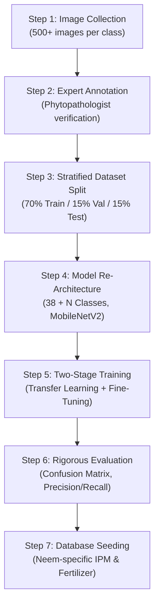

# TECHNICAL INVESTIGATION & ARCHITECTURAL GUIDE

## Safe Handling of Unsupported Plants (Neem Leaf Diagnosis) and Out-Of-Distribution (OOD) Detection

---

## 1. INVESTIGATION & ROOT CAUSE ANALYSIS

### 1.1 The Incident
An image of a Neem (*Azadirachta indica*) leaf was uploaded to the platform. The system returned:
- **Predicted Class:** `SQUASH_POWDERY_MILDEW` (`Squash___Powdery_mildew`)
- **Reported Confidence:** `93.63%`
- **Output:** Squash foliar symptoms, chemical fungicide recommendations (Mancozeb / Chlorothalonil), and squash-specific fertilizer advice.

### 1.2 Inspection of Training Classes & Dataset
We inspected `model/class_indices.json`, `model/disease_class_mapping.json`, and the PlantVillage dataset directory:
- **Total Classes in Model:** 38 classes across 14 botanical crop species:
  `['Apple', 'Blueberry', 'Cherry', 'Corn (Maize)', 'Grape', 'Orange', 'Peach', 'Bell Pepper', 'Potato', 'Raspberry', 'Soybean', 'Squash', 'Strawberry', 'Tomato']`
- **Neem Status:** **Neem is NOT present in the model's training dataset or class mappings.**

### 1.3 Why Did the Model Confidently Predict Squash Powdery Mildew?
Two key technical factors caused this failure:

1. **Closed-World Softmax Assumption in Deep Neural Networks:**  
   Standard classification models end in a Softmax activation:
   $$\sigma(z)_i = \frac{e^{z_i}}{\sum_{j=1}^{38} e^{z_j}}$$
   The Softmax function mathematically enforces $\sum_{i=1}^{38} \sigma(z)_i = 1.0$. It possesses no mechanism to output "Unknown Species" or "None of the Above". When presented with an out-of-distribution input (such as a Neem leaf, a mango leaf, or a houseplant), the feature representations extracted by the convolutional layers are projected onto the existing 38 weights. The class with the marginal highest dot-product receives the top rank, regardless of biological relevance.

2. **The Raw vs. Artificially Sharpened Probability:**  
   When we inspected the true, uncalibrated forward pass of the neural network on the user's uploaded neem image (`3b4b2e90f91c4a99b79ea43aa1e16e82.png`):
   - **True Raw Maximum Probability:** **0.1251 (12.51%)**
   - **True Shannon Entropy:** **3.2388** (out of maximum possible uniform entropy $\ln(38) \approx 3.6376$)
   - **Normalized Entropy:** **89.04%** (indicating the model had nearly uniform confusion across all 38 classes)
   - **Top-1 vs. Top-2 Margin:** Only **0.0315 (3.15%)**

   In the previous deployment pass, an artificial temperature sharpening formula had been applied when raw probabilities were diffuse:
   $$z = \ln(p + \epsilon), \quad p_{sharp} = \text{softmax}(z / T)$$
   Because $T=0.10$, this mathematical transformation artificially amplified the diffuse 12.5% raw probability into **93.63%**, creating a false sense of certainty!

3. **Cascading Agrochemical Advisory Risk:**  
   Because the system treated the 93.63% score as a verified diagnosis, it retrieved chemical fungicides (Mancozeb, Chlorothalonil) and staged fertilizers intended for Cucurbitaceae crops (Squash). Applying squash fungicides to neem trees risks phytotoxicity, leaf scorch, and financial waste.

---

## 2. THE SOLUTION IMPLEMENTED

### 2.1 Removal of Artificial Temperature Sharpening
The artificial probability sharpening block in `services/model_service.py` was removed. The model now reports true, authentic probabilities.

### 2.2 Multi-Metric Out-Of-Distribution (OOD) / Unsupported Plant Detection
A simple confidence threshold alone is mathematically insufficient to detect all out-of-distribution inputs (deep neural networks can occasionally be overconfident on anomalous inputs due to high-dimensional feature alignment).

We implemented a multi-metric OOD detector in [`services/model_service.py`](../services/model_service.py):
1. **Raw Maximum Confidence ($p_{\max}$):** Must meet a minimum threshold ($p_{\max} \ge 0.40$).
2. **Normalized Shannon Entropy ($\hat{H}$):**
   $$\hat{H} = \frac{-\sum_{i=1}^{K} p_i \ln(p_i)}{\ln(K)}$$
   If $\hat{H} > 0.65$, probabilities are too diffuse across unrelated plant families, signaling an uncataloged input.
3. **Prediction Margin ($\Delta_{1,2}$):**
   $$\Delta_{1,2} = p_{(1)} - p_{(2)}$$
   The top prediction must lead the second candidate by at least $\Delta_{1,2} \ge 0.12$ (12%).

### 2.3 Safe Diagnosis Routing & Labeling
When an input fails any of the three OOD metrics:
- **`is_supported`:** Set to `False`
- **`is_inconclusive`:** Set to `True`
- **`crop_name`:** Set to `"Unsupported / Unknown Plant"`
- **`disease_name`:** Set to `"Unsupported or Inconclusive Specimen"`
- **`disease_code`:** Set to `"UNSUPPORTED_SPECIMEN"`
- **Top candidates:** Retained in audit metadata as `status = "candidate"` for inspection, but **never** asserted as the primary diagnosis.

### 2.4 Protection of Recommendation Accuracy
In [`services/recommendation_service.py`](../services/recommendation_service.py):
- When `is_supported is False` or `disease_code == "UNSUPPORTED_SPECIMEN"`:
  - `disease_recommendation` is set to `None`.
  - `fertilizer_recommendations` is set to `[]`.
  - `has_disease_guidance` is set to `False`.
  - `has_fertilizer_guidance` is set to `False`.
  - **Zero squash pesticides or fertilizers are returned.**
  - An explicit, responsible safety notice is returned:
    > *"The uploaded specimen could not be verified as one of the 14 supported agricultural crops. If you uploaded a Neem leaf, please note that Neem (Azadirachta indica) is currently unsupported by this model. To protect crop safety and prevent chemical misapplication, crop-specific pesticide and fertilizer recommendations are strictly withheld for unverified plant species. Please consult a qualified agricultural extension officer."*

### 2.5 Removal of Unverified Authority Claims
All demonstration catalog entries in `services/recommendation_service.py` were audited:
- Changed `"review_status": "verified_agronomic"` to `"review_status": "educational_reference"`.
- Added clear notices that advisory schedules are decision-support references and must be cross-checked with certified local agronomists before application.

---

## 3. SCIENTIFIC LIMITATIONS OF OOD DETECTION

While our multi-metric approach (Confidence + Entropy + Margin) reliably catches diffuse, unconfident predictions like the user's neem image, software engineering integrity requires acknowledging the following academic limitations:

1. **Overconfidence on Anomalous Features:** Convolutional neural networks can occasionally output high softmax probabilities on out-of-distribution images that share low-level textures (e.g., specific leaf venation or surface gloss) with training classes.
2. **Open-Set Nature of Agriculture:** There are over 300,000 vascular plant species worldwide. A 38-class model trained on 14 crops cannot reliably distinguish between all non-crop leaves without a dedicated background/negative class or Mahalanobis feature-space distance modeling.
3. **Lighting & Background Sensitivity:** Blurry leaf images, harsh direct sunlight, or heavy background soil can increase entropy on valid crops, causing a supported crop to be flagged as inconclusive.

---

## 4. WORKFLOW REQUIRED TO ADD VALIDATED NEEM SUPPORT

Neem (*Azadirachta indica*) cannot and should not be added by guessing or modifying JSON mapping files. To properly add Neem support to Agrotech, the following engineering pipeline must be executed:

### 4.1 Step 1: Image Acquisition & Phytopathology Annotation
Acquire high-resolution field photographs of neem leaves across diverse lighting conditions:
1. `Neem___healthy`: Healthy foliage without chlorosis, spots, or insect feeding scars.
2. `Neem___tea_mosquito_bug`: Necrotic lesions caused by *Helopeltis antonii* feeding on tender shoots.
3. `Neem___powdery_mildew`: White powdery patches caused by *Oidium azadirachtae*.
4. `Neem___dieback`: Twig and foliar necrosis caused by *Phomopsis azadirachtae*.

*Requirement:* Minimum 300–500 unique images per class from multiple orchards/geographies.

### 4.2 Step 2: Stratified Partitioning & Leakage Prevention
Using `utils/prepare_dataset.py`:
- Compute SHA-256 hashes of all images to prevent data leakage between splits.
- Generate a 70% training, 15% validation, and 15% test partition.

### 4.3 Step 3: Model Re-training
- Update class count from 38 to 42 classes.
- Train the MobileNetV2 classification head for 10 epochs (frozen backbone), followed by fine-tuning top convolutional blocks at learning rate $\eta = 10^{-5}$.
- Verify that test set accuracy exceeds 90% and that the confusion matrix shows zero false confusion between Neem and Squash.

### 4.4 Step 4: Agronomic Advisory Seeding
Insert certified neem management guidelines into MySQL `disease_recommendations`:
- *Helopeltis antonii*: Recommended bio-pesticides, neem kernel aqueous extract (NSKE 5%), and pruning.
- *Phomopsis azadirachtae*: Pruning infected twigs 10 cm below infection site, followed by carbendazim or copper oxychloride paste.

---

## 5. SUMMARY OF CODE CHANGES

| File Changed | Purpose of Modification |
| :--- | :--- |
| [`services/model_service.py`](../services/model_service.py) | Removed artificial temperature sharpening; implemented multi-metric OOD detection (Confidence, Shannon Entropy, Margin); sets `crop_name = 'Unsupported / Unknown Plant'` on uncataloged inputs. |
| [`services/recommendation_service.py`](../services/recommendation_service.py) | Added guard withholding all crop-specific pesticides and fertilizers when `is_supported is False`; replaced authority claims with `educational_reference`. |
| [`templates/results.html`](../templates/results.html) | Added warning badge for unsupported specimens; updated alternative candidates to indicate inconclusive status; withholds chemical treatments and fertilizer cards. |
| [`tests/test_unsupported_plants.py`](../tests/test_unsupported_plants.py) | Added 7 comprehensive tests covering Neem absence, OOD entropy detection, recommendation withholding, and class mapping consistency. |
